# Redbook

CDDA CD digital audio as per RedBook (IEC 60908:1999) in rust.

> tldr; A load of glue for working with audio CDs + some windows apps

## Library

Most of what this library provides is "glue", bringing together crates which cover different parts of the CD audio landscape into a single, coherent whole.

### End-to-end functionality

1. **Hardware access** Read audio data from a CD
2. **Parse & lookup** information on the album, generate tags & embeddable coverart
3. **Encode music** to wav or flac

### Structure

There are 3 key entry points to the crate, one each for hardware, CD structure, and music data.

- `struct AudioCd` - the main entry point for interfacing with hardware
- `struct Disc` - the main entry point for working with the contents of a CD
- `struct RippedTrack` - the main entry point for the actual music of a given track

### Errors

The library uses a hand-rolled 3-level error hierarchy (full conventions in the `redbook::error`
module docs). Every error type implements `std::error::Error + Send + Sync + 'static`; error
enums are not `#[non_exhaustive]`. Context is the *data which led to the error*, stored in the
variant itself — there is no stringly-typed `.context(...)` API. A variant wrapping an underlying
error is returned by `source()` and *not* rendered by `Display`; data-carrying variants are
rendered by `Display` and return `None` from `source()`. All error types implement
`RedbookError` and convert to `io::Error` explicitly via `into_io_error()` — never via
`From<_> for io::Error` — so each call site decides the `ErrorKind` and how to treat an
underlying `io::Error` further down the stack; the kind of any underlying `io::Error` is
preserved, otherwise a per-type default applies (`ErrorKind::Other` at worst).

```mermaid
flowchart TD
    subgraph L1["Level 1 — crate root: crates/redbook/src/error.rs"]
        Error["redbook::Error — enum · impl Error<br/>redbook::Result<T, E = Error>"]
    end

    Error -->|"DeviceError(DeviceError)"| DeviceError
    Error -->|"DriveError(DriveError)"| DriveError
    Error -->|"TocError(TocError)"| TocError
    Error -->|"DiscError(DiscError)"| DiscError
    Error -->|"EncodingError(EncodingError)"| EncodingError
    Error -->|"Other(Box<dyn C_GOOD_ERROR>)"| IO["any other error, incl. io::Error — foreign"]
    Error --> ThreadCancellation["ThreadCancellation"]

    subgraph L2toc["Level 2 — toc: toc/error.rs (toc::TocResult<T> alias)"]
        TocError["toc::TocError — enum · impl Error"]
        TocError --> TE1["InvalidTrackEntry(RawTocEntry)"]
        TocError --> TE2["InvalidLeadoutEntry(RawTocEntry)"]
        TocError --> TE3["InvalidInfoEntry(RawTocEntry)"]
        TocError --> TE4["InvalidTrackNo(InvalidTrackNo)"]
        TocError --> TE5["MultipleDiscs"]
        TocError --> TE6["InfoMismatch { entry: InfoEntry, found: Option<TrackNo> }"]
        TocError --> TE7["InconsistentSessionInfo"]
        TocError --> TE8["LeadoutMismatch { sessions: Option<NonZeroUsize>, leadouts: usize }"]
        TocError --> TE9["InvalidOrder(InvalidOrder)"]
        TocError --> TE10["NotFound"]
        TocError -->|"CdToc(cdtoc::TocError)"| CDTOC["cdtoc::TocError — foreign"]
    end
    TE4 --> ITN
    TE9 --> INO

    subgraph L2disc["Level 2 — disc: disc/error.rs"]
        DiscError["disc::DiscError — enum · impl Error"]
        DiscError --> DM["TocMismatch(TocMismatch)"]
        DiscError --> DT["TaggingError(TaggingError)"]
        DiscError --> D2["NoReleases"]
        DiscError --> D3["ThreadCancellation — From<Context<R>>"]
        DiscError --> DIo["IoError(IoError)"]
    end
    DM --> TM["disc::error::TocMismatch — enum · impl Error"]
    TM --> TM1["Mismatch { provided: Track, from_toc: cdtoc::Track }"]
    TM --> TM2["ExtraProvided(Track)"]
    TM --> TM3["ExtraInToc(cdtoc::Track)"]
    DT --> TG["disc::error::TaggingError — enum · impl Error"]
    TG --> TG1["UnknownMimeType(UnknownMimeType)"]
    TG -->|"MetaflacError(metaflac::Error)"| MF["metaflac::Error — foreign"]
    TG1 --> UM
    DIo --> IOE["disc::error::IoError — enum · impl Error"]
    IOE -->|"MusicBrainz(Box<ApiEndpointError>)"| MB["musicbrainz_rs::ApiEndpointError — foreign"]
    IOE -->|"Http(reqwest::Error)"| REQ["reqwest::Error — foreign"]
    IOE -->|"StdIoError(io::Error)"| IO

    subgraph L2track["Level 2 — track: track/error.rs"]
        EncodingError["track::EncodingError — enum · impl Error"]
        EncodingError --> TR1["InvalidData(usize) — raw byte length"]
        EncodingError --> TR2["FlacError(FlacError)"]
    end
    TR2 --> FE["track::error::FlacError — enum · impl Error"]
    FE --> FE1["InvalidEncoder(flacenc::error::VerifyError)"]
    FE --> FE2["InvalidData(String) — flacenc SourceError is !Send, message retained"]
    FE -->|"OutputError(OutputError<ByteSink>)"| FEO["flacenc::OutputError — foreign"]

    subgraph L2drive["Level 2 — drive: drive/error.rs"]
        DriveError["drive::DriveError — enum · impl Error"]
        DriveError -->|"DeviceError(DeviceError)"| DeviceError
        DriveError --> DR1["NotFound(TrackNo)"]
        DriveError --> DR2["NoDrivesFound"]
        DriveError --> DR3["ZeroLengthTrack"]
        DriveError --> DR4["InvalidFrame(InvalidFrame)"]
        DriveError --> DR5["Progress(RipProgress)"]
        DriveError --> DR6["ThreadCancellation — From<Context<RipProgress>>"]
    end

    subgraph L2dev["Level 2 — drive: drive/error.rs (Device trait contract)"]
        DeviceError["drive::error::DeviceError — enum · impl Error"]
        DeviceError --> DV1["InvalidBufferSize(InvalidBufferSize)"]
        DeviceError -->|"NotReady(io::Error) — ERROR_NOT_READY = 21, no disc in drive"| IO
        DeviceError --> DV2["UnexpectedEndOfRead { expected, received }"]
        DeviceError --> DV3["UnsupportedDevice"]
        DeviceError -->|"Other(io::Error)"| IO
        DeviceError -->|"TocError(TocError)"| TocError
    end
    DV1 --> IBSZ

    subgraph L2win["Level 2 — win: win/error.rs"]
        WinError["win::WinError — struct, OsError wrapper around io::Error<br/>converts into DeviceError::NotReady / DeviceError::Other at the Device boundary"]
        WinError -->|"From<WinError> for DeviceError"| DeviceError

        CdaError["win::error::CdaError — enum · impl Error (.cda file parsing)"]
        CdaError --> C1["InvalidTrackNo(InvalidTrackNo)"]
        CdaError --> C2["InvalidFrame(InvalidFrame)"]
        CdaError --> C3["InvalidLength { expected, actual }"]
        CdaError --> C4["InvalidHeader([u8; 4])"]
        CdaError --> C5["InvalidChunkSize { expected, actual }"]
        CdaError --> C6["InvalidFilename(PathBuf)"]
        CdaError --> C7["InvalidVersion(u16)"]
        CdaError --> C8["MismatchedStart { relative, absolute: Msf }"]
        CdaError --> C9["MissingNullByte"]
        CdaError --> C10["MismatchedDuration { frames: Frame, msf: Msf }"]
        CdaError -->|"IoError(io::Error)"| IO
    end
    C1 --> ITN
    C2 --> IF

    subgraph L3["Level 3 — leaf structs: frame.rs / toc/error.rs / drive/error.rs / disc/error.rs"]
        ITN["toc::error::InvalidTrackNo(i128) — struct · impl Error<br/>wide ctor InvalidTrackNo::new (i128: From<N>)<br/>TrackNo::new -> Result<_, InvalidTrackNo>, checked_new -> Option"]
        INO["toc::error::InvalidOrder — struct · impl Error<br/>InvalidOrder::new(format, first_entry, second_entry)"]
        IF["frame::InvalidFrame(i128) — struct · impl Error<br/>Frame::new -> Result<_, InvalidFrame>"]
        IBS["frame::InvalidByteSize(i128) — struct · impl Error<br/>ByteSize::new -> Result<_, InvalidByteSize>"]
        IBSZ["drive::error::InvalidBufferSize — enum · impl Error"]
        UM["disc::error::UnknownMimeType(Box<str>) — struct · impl Error"]
    end
```



Notes: `Device::Iter` yields `Result<_, DeviceError>` items and `CdDrives` yields
`Result<_, Error>` items (#50) — `None` is reserved for the expected end-of-enumeration;
no-disc (`ERROR_NOT_READY`) drives are still skipped. `hex::ParseHexError` is deliberately
outside the hierarchy (#165). Wrapped OS errors keep
`raw_os_error` end-to-end: `RedbookError::raw_os_error` walks the `source()` chain to the
original `io::Error` (e.g. via `DeviceError::NotReady`/`Other`, which `WinError` converts into
at the `Device` boundary).

### Example

```rust
use redbook::{AudioCd, CdDrives, RipProgress, TrackNo, Result, drive::DriveError};
use thread_safely::Controller;

// Allow for status updates & cancellation mid-rip
let (rip_controller, rip_context) = Controller::<RipProgress>::new();

// Find & open the first available CD drive
let mut available_drives = CdDrives::all(rip_context)?;
let drive = available_drives.next().ok_or(DriveError::NoDrivesFound)??;
let mut cd = AudioCd::try_from(drive)?;

// Try to get data on this cd from musicbrainz. Continue on (network) errors.
let _ignore_failure = cd.disc_mut().update_musicbrainz();

// Rip the first track & encode it to flac
let track1 = cd.rip(TrackNo::strict_new(1))?;
let flac = track1.to_flac()?;
```

### Core functionality alternatives

Most of these are the individual crates which are glued together:

- [cdda_reader](https://crates.io/crates/cd-da-reader) - for direct access to data from audio CDs. This one I didn't use: there are no safety comments around the unsafe ffi calls and I soon realised that auditing them would be at least as much work as re-implementing. Then I noticed that there are safer ways to use the windows ffi than those that `cdda_reader` chooses. If you are looking for something to support reading audio CDs in linux or mac then try this - they are both still to-do for `redbook`.
- [cdtoc](https://crates.io/crates/cdtoc) - for parsing a TOC (table of contents) and calculating links/IDs for online directories
- [musicbrainz_rs](https://crates.io/crates/musicbrainz_rs) - for querying MusicBrainz and parsing the results
- [flacenc](https://crates.io/crates/flacenc) - for encoding to FLAC (currently slightly broken after changes to `portable_simd` earlier this year)
- [metaflac](https://crates.io/crates/metaflac) - for tagging FLAC files

### Tracing

Redbook leverages [tracing](https://crates.io/crates/tracing). Info, Warn & Error messages
are designed to be directly usable as output from a CLI binary.

### Safety

- Unsafe code is limited to specific hardware access modules.
- `#![deny(unsafe_code)]` with a wide selection of additional lints defined in `Cargo.toml`
- All other modules are marked `#[forbid(unsafe_code)]`.
- Every unsafe call is annotated with `#[expect(unsafe_code, reason = "...")]`.
- All unsafe code includes full safety comments.
- All ffi calls are also mocked with full safety instructions, ensuring that IDE integration
  provides these details in-situ. The correctness of the mock signatures is validated on every
  test run.
- We use miri to check for potential UB (thanks to the mocks we can create tests for miri to run
  that validate all the unsafe callsites)
- It goes without saying but, ALL unsafe code is *hand crafted by humans*. Agents.md
  specifically forbids any unsafe code changes or generation.

### Thread Safety

File handles are not `Sync`, but you almost certainly will want to split reading data from a CD
and processing that data into separate threads. To share an `AudioCd` between threads, wrap it
in an `Arc<Mutex<AudioCd>>`: update & mutate metadata via `disc_mut()` first, then lock and
spawn threads to read & encode.

### Nightly only

This crate is nightly only for a few reasons:

- I want to rely on downstream crates which use nightly features, in particular: leveraging
  `poratble_simd` in [`flacenc`](https://crates.io/crates/flacenc) (currently disabled); and `try_trait_v2` for [`exit_safely`](https://crates.io/crates/exit_safely) in
  binaries & tracing ergonomics via [`tracing_result`](https://crates.io/crates/tracing_result).
- I find many of the ergonomic benefits worth the toolchain restriction.
- I want to support development of the language and stabilisation of new features.
The crate uses [`build_safely`](https://crates.io/crates/build_safely) to ensure that every experimental feature behaves as expected and
to avoid future lint errors for stable features

### Limitations / TODOs

Currently this library only supports things I want to use personally. That means:

- **Hardware access** is limited to Windows. Linux is todo; Mac is open for contributions.
- **Online services** are limited to MusicBrainz. Other services are open for contributions.
- **Output formats** are limited to wav and flac. Other formats are open for contributions.

## Apps

- rip.exe     - GUI app to rip a CD to flac (separate crate `redbook-rip`)
- rip-cli.exe - pure cli ripper
- drives.exe  - list the available CD drives
- toc.exe     - dump the TOC as windows reads it
- tag.exe     - read tags from a flac file

GUI apps are made with [](https://slint.dev/)
