# Redbook

CDDA CD digital audio as per RedBook (IEC 60908:1999) in rust.

> tldr; A load of glue for working with audio CDs + some windows apps

## Library

Most of what this library provides is "glue", bringing together crates which cover different parts of the CD audio landscape into a single, coherent whole.

### End-to-end functionality

1. **Hardware access** Read audio data from a CD
2. **Parse & lookup** information on the album, generate tags & embeddable coverart
3. **Encode music** to wav or flac

### Structure

There are 3 key entry points to the crate, one each for hardware, CD structure, and music data.

- `struct AudioCd` & `trait AudioCdExt` - the main entry point for interfacing with hardware
- `struct Disc` - the main entry point for working with the contents of a CD
- `struct RippedTrack` - the main entry point for the actual music of a given track

### Errors

The library uses a hand-rolled 3-level error hierarchy (full conventions in the `redbook::error`
module docs). Every error type implements `std::error::Error + Send + Sync + 'static`; error
enums are not `#[non_exhaustive]`. Context is the *data which led to the error*, stored in the
variant itself — there is no stringly-typed `.context(...)` API. A variant wrapping an underlying
error is returned by `source()` and *not* rendered by `Display`; data-carrying variants are
rendered by `Display` and return `None` from `source()`. All error types convert to `io::Error`
preserving the call site's status-quo `ErrorKind`.

```mermaid
flowchart TD
    subgraph L1["Level 1 — crate root: crates/redbook/src/error.rs"]
        Error["redbook::Error — enum · impl Error<br/>redbook::Result<T, E = Error>"]
    end

    Error -->|"Io(io::Error)"| IO["io::Error — foreign (std)"]
    Error -->|"Toc(TocError)"| TocError
    Error -->|"Disc(DiscError)"| DiscError
    Error -->|"Tagging(TaggingError)"| TaggingError
    Error -->|"Track(TrackError)"| TrackError
    Error -->|"Drive(DriveError)"| DriveError
    Error -->|"Win(WinError)"| WinError

    subgraph L2toc["Level 2 — toc: toc/error.rs (toc::TocResult<T> alias)"]
        TocError["toc::TocError — enum · impl Error"]
        TocError --> TE1["InvalidTrackEntry(RawTocEntry)"]
        TocError --> TE2["InvalidLeadoutEntry(RawTocEntry)"]
        TocError --> TE3["InvalidInfoEntry(RawTocEntry)"]
        TocError --> TE4["InvalidTrackNo(InvalidTrackNo)"]
        TocError --> TE5["MultiDisc"]
        TocError --> TE6["InfoMismatch { entry: InfoEntry, found: Option<TrackNo> }"]
        TocError --> TE7["InconsistentSessionInfo"]
        TocError --> TE8["LeadoutMismatch { sessions, leadouts }"]
        TocError --> TE9["InvalidOrder { this: TocEntry, next: TocEntry }"]
        TocError --> TE10["NotFound"]
        TocError -->|"CdToc(cdtoc::TocError)"| CDTOC["cdtoc::TocError — foreign"]
        TocError -->|"Io(io::Error)"| IO
    end
    TE4 --> ITN

    subgraph L2disc["Level 2 — disc: disc/error.rs"]
        DiscError["disc::DiscError — enum · impl Error"]
        DiscError --> DM["TrackMismatch(TrackMismatch)"]
        DiscError --> D2["NoReleases"]
        DiscError --> D3["Cancelled — From<Context<R>>"]
        DiscError -->|"MusicBrainz(Box<ApiEndpointError>)"| MB["musicbrainz_rs::ApiEndpointError — foreign"]
        DiscError -->|"Http(reqwest::Error)"| REQ["reqwest::Error — foreign"]
        DiscError -->|"Io(io::Error)"| IO
    end
    DM --> TM["disc::TrackMismatch — enum · impl Error"]
    TM --> TM1["Mismatch { provided: Track, from_toc: cdtoc::Track }"]
    TM --> TM2["ExtraProvided(Track)"]
    TM --> TM3["ExtraInToc(cdtoc::Track)"]

    subgraph L2tag["Level 2 — tagging: tagging/error.rs"]
        TaggingError["tagging::TaggingError — enum · impl Error"]
        TaggingError --> TG1["UnknownMimeType(Box<str>)"]
        TaggingError -->|"Metaflac(metaflac::Error)"| MF["metaflac::Error — foreign"]
        TaggingError -->|"Io(io::Error)"| IO
    end

    subgraph L2track["Level 2 — track: track/error.rs"]
        TrackError["track::TrackError — enum · impl Error"]
        TrackError --> TR1["InvalidData(usize) — raw byte length"]
        TrackError --> TR2["Encode(String) — flacenc EncodeError is !Send, message retained"]
        TrackError -->|"Output(OutputError<ByteSink>)"| FE["flacenc::OutputError — foreign"]
    end

    subgraph L2drive["Level 2 — drive: drive/error.rs"]
        DriveError["drive::DriveError — enum · impl Error"]
        DriveError --> DR1["NotFound(TrackNo)"]
        DriveError --> DR2["UnexpectedEof"]
        DriveError --> DR3["FileTooLarge(ByteSize)"]
        DriveError --> DR4["InvalidData"]
        DriveError --> DR5["Unsupported"]
        DriveError --> DR6["OutOfMemory(usize) — attempted buffer size"]
        DriveError --> DR7["Cancelled — From<Context<R>>"]
        DriveError --> DR8["Progress"]
        DriveError -->|"Io(io::Error)"| IO
        DriveError -->|"Win(WinError)"| WinError
        DriveError -->|"Toc(TocError)"| TocError
    end

    subgraph L2win["Level 2 — win: win/error.rs"]
        WinError["win::WinError — enum · impl Error"]
        WinError --> W1["CdaError(CdaError)"]
        WinError -->|"Io(io::Error)"| IO
        WinError --> W3["NotReady — ERROR_NOT_READY = 21, no disc in drive"]
        WinError --> W4["InvalidData"]
        WinError --> W5["InvalidFilename"]
        WinError --> W6["Unsupported"]
        WinError --> W7["OutOfMemory"]
        WinError --> W8["UnexpectedEof { expected, received }"]
        WinError -->|"Toc(TocError)"| TocError

        CdaError["win::error::CdaError — enum · impl Error (.cda file parsing)"]
        CdaError --> C1["InvalidTrackNo(InvalidTrackNo)"]
        CdaError --> C2["InvalidFrame(InvalidFrame)"]
        CdaError --> C3["InvalidLength { expected, actual }"]
        CdaError --> C4["InvalidHeader([u8; 4])"]
        CdaError --> C5["InvalidChunkSize { expected, actual }"]
        CdaError --> C6["InvalidVersion(u16)"]
        CdaError --> C7["MismatchedStart { relative, absolute: Msf }"]
        CdaError --> C8["MissingNullByte"]
        CdaError --> C9["MismatchedDuration { frames: Frame, msf: Msf }"]
    end
    W1 --> CdaError
    C1 --> ITN
    C2 --> IF

    subgraph L3["Level 3 — leaf structs & frame errors: frame.rs / toc/error.rs"]
        ITN["toc::error::InvalidTrackNo(i128) — struct · impl Error<br/>wide ctor InvalidTrackNo::new (i128: From<N>)<br/>TrackNo::new -> Result<_, InvalidTrackNo>, checked_new -> Option"]
        IF["frame::InvalidFrame(i128) — struct · impl Error<br/>Frame::new -> Result<_, InvalidFrame>"]
        IBS["frame::InvalidByteSize(i128) — struct · impl Error<br/>ByteSize::new -> Result<_, InvalidByteSize>"]
        PBS["frame::ParseByteSizeError — enum · impl Error (ByteSize::from_str, #186)"]
        PBS -->|"Int(ParseIntError)"| PI["ParseIntError — foreign (std)"]
        PBS --> P2["TooLarge(InvalidByteSize)"]
    end
    P2 --> IBS
```



Notes: `Device::Iter` / `CdDrives` yield `Result<_, DriveError>` items (#50) — `None` is reserved
for the expected end-of-enumeration; no-disc (`ERROR_NOT_READY`) drives are still skipped.
`hex::ParseHexError` is deliberately outside the hierarchy (#165). Wrapped OS errors keep
`raw_os_error` end-to-end (`From<WinError> for io::Error` returns the original `io::Error`
directly for `WinError::Io`).

### Example

```rust
// Open a handle to the drive and read table of contents from the CD
let mut cd: AudioCd = AudioCd::new(drive_path)?;

// Try to get data on this cd from musicbrainz. Continue on (network) errors.
let _ = cd.disc_mut().update_musicbrainz();

// There are often multiple releases with the same tracks - select the right one.
cd.disc_mut().set_release(2);

// Try to get the cover art from CoverArtArchive based on the musicbrainz info.
let _ = cd.disc_mut().update_cover_art();

// Make the AudioCd immutable, so we can safely spawn separate threads to rip & encode data.
let cd = cd.lock();

// rip the first track
let track1 = cd.rip(TrackNo(1))?;

// encode the first track to flac
let track1_flac = track1.to_flac();

// get the tags & embeddable cover art
let tags: Option<VorbisComment> = disc.tag_for(TrackNo(1));
let cover: Option<&Picture> = disc.cover_art();
```

### Core functionality alternatives

Most of these are the individual crates which are glued together:

- [cdda_reader](https://crates.io/crates/cd-da-reader) - for direct access to data from audio CDs. This one I didn't use: there are no safety comments around the unsafe ffi calls and I soon realised that auditing them would be at least as much work as re-implementing. Then I noticed that there are safer ways to use the windows ffi than those that `cdda_reader` chooses. If you are looking for something to support reading audio CDs in linux or mac then try this - they are both still to-do for `redbook`.
- [cdtoc](https://crates.io/crates/cdtoc) - for parsing a TOC (table of contents) and calculating links/IDs for online directories
- [musicbrainz_rs](https://crates.io/crates/musicbrainz_rs) - for querying MusicBrainz and parsing the results
- [flacenc](https://crates.io/crates/flacenc) - for encoding to FLAC (currently slightly broken after changes to `portable_simd` earlier this year)
- [metaflac](https://crates.io/crates/metaflac) - for tagging FLAC files

### Tracing

Redbook leverages [tracing](https://crates.io/crates/tracing). Info, Warn & Error messages
are designed to be directly usable as output from a CLI binary.

### Safety

- Unsafe code is limited to specific hardware access modules.
- `#![deny(unsafe_code)]` with a wide selection of additional lints defined in `Cargo.toml`
- All other modules are marked `#[forbid(unsafe_code)]`.
- Every unsafe call is annotated with `#[expect(unsafe_code, reason = "...")]`.
- All unsafe code includes full safety comments.
- All ffi calls are also mocked with full safety instructions, ensuring that IDE integration
  provides these details in-situ. The correctness of the mock signatures is validated on every
  test run.
- We use miri to check for potential UB (thanks to the mocks we can create tests for miri to run
  that validate all the unsafe callsites)
- It goes without saying but, ALL unsafe code is *hand crafted by humans*. Agents.md
  specifically forbids any unsafe code changes or generation.

### Thread Safety

File handles are not `Sync`, but you almost certainly will want to split reading data from a CD
and processing that data into separate threads. To facilitate this `AudioCdExt` and
`AudioCdExtMut` are separate traits. See the example for how to take advantage to initially
update and mutate metadata, before obtaining calling `lock` and spawning
threads to use that data.

### Nightly only

This crate is nightly only for a few reasons:

- I want to rely on downstream crates which use nightly features, in particular: leveraging
  `poratble_simd` in [`flacenc`](https://crates.io/crates/flacenc) (currently disabled); and `try_trait_v2` for [`exit_safely`](https://crates.io/crates/exit_safely) in
  binaries & tracing ergonomics via [`tracing_result`](https://crates.io/crates/tracing_result).
- I find many of the ergonomic benefits worth the toolchain restriction.
- I want to support development of the language and stabilisation of new features.
The crate uses [`build_safely`](https://crates.io/crates/build_safely) to ensure that every experimental feature behaves as expected and
to avoid future lint errors for stable features

### Limitations / TODOs

Currently this library only supports things I want to use personally. That means:

- **Hardware access** is limited to Windows. Linux is todo; Mac is open for contributions.
- **Online services** are limited to MusicBrainz. Other services are open for contributions.
- **Output formats** are limited to wav and flac. Other formats are open for contributions.

## Apps

- rip.exe     - rip a CD to flac
- rip_cli.exe - pure cli ripper
- toc.exe     - dump the TOC as windows reads it
- tag.exe     - read tags from a flac file

GUI apps are made with [](https://slint.dev/)
